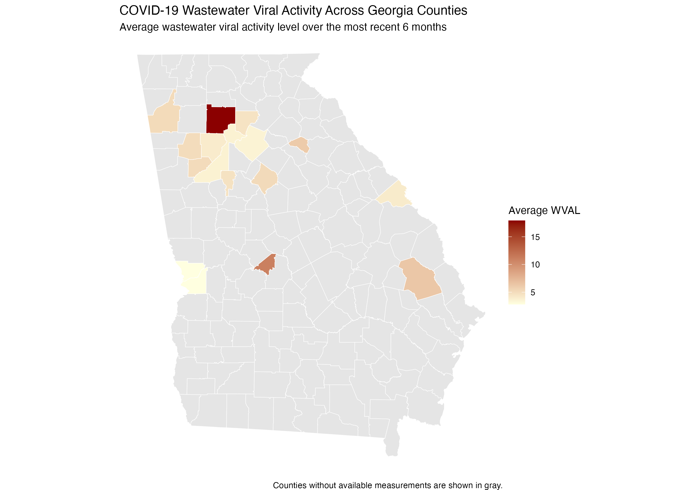

<style>
body {font-family: "Times New Roman", Times, serif;}

#header {text-align: center;}
</style>

```{r, set-chunk-opts, include = FALSE}
library(knitr)
opts_chunk$set(
  echo = FALSE, warning = FALSE, message = FALSE
)
```

## Introduction 

Wastewater based epidemiology(WBE) has reemerged as a public health surveillance tool for tracking infectious diseases at the community level through the analysis of sewage. Increased interest occurred during the COVID-19 (SARS-COV-2) pandemic, with the Centers for Disease Control and Prevention (CDC) establishing the National Wastewater Surveillance System (NWSS) partnering with major projects like WastewaterSCAN. 

This report utilizes the CDC Wastewater Viral Activity Level (WVAL), which records weekly surveillance measurements across U.S wastewater treatment faculties for respiratory pathogens such Sars-Cov-2.  

## Objectives
1. Load the wastewater surveillance dataset 
2. Construct summary tables evaluating categorical viral activity 
3. Visualize the viral activity levels over time to identify seasonal trends 

## Clean data

### Variables of interest:

**record_id**: A unique identifier for each row of data

**sample_collect_date**: Sample collection date YYYY-MM-DD

**site**: A unique identifier for wastewater treatment plants

**state_territory**: Set to GA, state in which the wastewater treatment plant is located

**source**: The source of the data submitted to NWSS (e.g, State_Territory, WastewaterSCAN, CDC_Verily, & CDC_Biobot)

**counties_served**: The county and county-equivalent names corresponding to the FIPS codes in 'county_fips'

**population_served**: Estimated number of persons served by this sampling site (i.e., served by this wastewater treatment plant or, if 'sample_location' is "upstream", then by this upstream location)

**pcr_target**: The target of the PCR quantification (pathogen or antimicrobial resistance (AMR) groups)

**sample_location**: Sample collection location in the wastewater system, whether at a wastewater treatment plant  or upstream in the wastewater system

**pcr_target_detect**: The target of the PCR quantification (pathogen or antimicrobial resistance (AMR) groups)

**sample_matrix**: Wastewater matrix from which the sample was collected. Wastewater matrix is a categorical variable specifying the type of wastewater sample used (e.g., raw influent, primary sludge, settled solids)

***wval***:The calculated site wastewater viral activity level (WVAL) for the CDC/MMWR reporting week

***wval_category***:	Category for the calculated site WVAL for the CDC/MMWR reporting week. Categories are ordinal based on pathogen specific cut-offs of WVAL values: very low, low, moderate, high, very high; and includes a 'limited/no data' category when there is insufficient data to calculate a WVAL

```{r, load-data}
here::i_am(
  "final_report.Rmd"
)

data <- readRDS(
  file =
    here::here("data/clean/wastewater_clean.rds")
)
```

# Descriptive Analysis

## Tabular analysis

```{r table1, echo=FALSE}
table_one <- readRDS(
  file = here::here("output/table_one.rds")
)

table_one
```

### Table One Description
Across 10,429 SARS-CoV-2 wastewater surveillance observations in Georgia, the median wastewater viral activity level was 2.6 (IQR: 1.1–5.6). Most observations were classified as having very low or low viral activity, 37% and 22% of observations, respectively, while 16% were classified as very high. SARS-CoV-2 was detected in 95% of observations. The most common sample matrix was raw wastewater (48%), followed by post-grit removal samples (41%), and primary sludge (11%).

## Visualizing Analysis

```{r figure-one, echo=FALSE, message=FALSE, warning=FALSE, out.width="100%"}
map_months <- params$map_months
source("code/02_figure1.R")

```

## Figure 1: Average SARS-CoV-2 Wastewater Viral Activity by County in Georgia
This map illustrates the geographic distribution of average SARS-CoV-2 wastewater viral activity levels (WVAL) across Georgia counties using the most recent `r params$map_months` months of available surveillance data. Darker shades of red indicate higher average viral activity, while lighter shades indicate lower activity. Counties without available wastewater surveillance data are shown in gray.

### Figure 2: Wastewater Viral Activity Over Time

```{r figure2, echo=FALSE, out.width="90%", fig.align="center"}
knitr::include_graphics(
  here::here("output/figure_two.png")
)
```

### Figure 2 Description 
Figure 2 shows monthly average SARS-CoV-2 wastewater viral activity levels (WVAL) in Georgia from January 2022 to November 2026. Major peaks were observed around July 2022, January 2023, January 2024, and September 2026. Raw wastewater generally showed the highest peaks, reaching approximately 15 in July 2022 and 17–18 in September 2026. All three sample matrices showed similar increases and decreases over time, although raw wastewater had greater fluctuations. These findings highlight changes in SARS-CoV-2 wastewater viral activity over the study period, with no clear consistent seasonal pattern across all years.

## References
https://www.cdc.gov/wastewater/about-data/index.html

https://pmc-ncbi-nlm-nih-gov.proxy.library.emory.edu/articles/PMC11312382/

https://www.nature.com/articles/s41370-024-00683-w#citeas

https://www-cdc-gov.proxy.library.emory.edu/wastewater/about/wval.html
